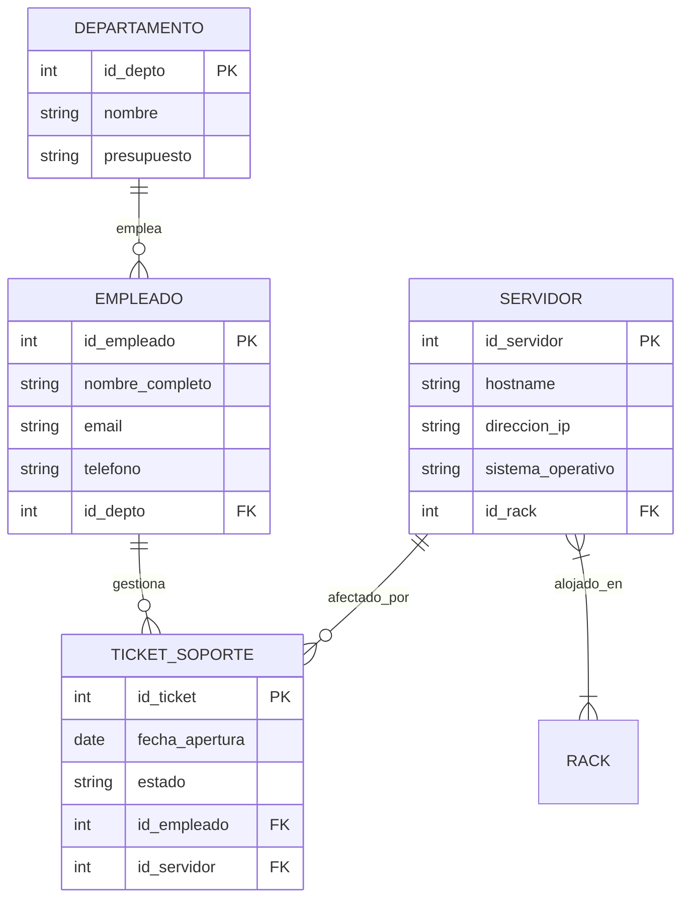

# 02 - Modelado Conceptual de Datos: Modelo Entidad / Relación (E-R) y Extendido

> **Fuente:** [https://campus.europaeducationgroup.es/courses/143845](https://campus.europaeducationgroup.es/courses/143845)  
> **Módulo:** Unidad 02 y 03. Modelado de datos. El modelo entidad/relación y extendido

## 📌 Conceptos Clave
- **Modelo Entidad-Relación (Peter Chen, 1976):** Notación gráfica conceptual para estructurar los requisitos de información del mundo real independientemente del software SGBD final.
- **Entidades Fuertes vs Débiles:** Entidades con existencia propia e identificador primario frente a entidades dependientes de la existencia o identificación de otra entidad padre.
- **Tipología de Atributos:** Simples, Compuestos, Monovaluados, Multivaluados, Derivados o Calculados, y Atributos Clave.
- **Cardinalidad de las Relaciones:** Razón de cardinalidad máxima y mínima: $1:1$, $1:N$ y $N:M$.
- **Extensiones del Modelo (E-R Extendido):** Jerarquías de **Generalización / Especialización (Herencia)** clasificadas por exclusividad (Disjunta vs Solapada) y participación (Total vs Parcial).

---

## 📖 Desarrollo y Resumen

### 1. Elementos Fundamentales del Modelo E-R
1. **Entidad:** Objeto o concepto del mundo real sobre el que se almacena información (ej. `CLIENTE`, `PRODUCTO`, `SERVIDOR`).
2. **Atributo:** Propiedad o característica de una entidad (ej. `DNI`, `Nombre`, `DireccionIP`).
   - *Clave Primaria:* Atributo (o conjunto de atributos) cuyo valor identifica unívocamente a cada ejemplar de la entidad.
   - *Atributo compuesto:* Desglosable en partes elementales (ej. `Dirección` formada por `Calle`, `Número`, `CódigoPostal`).
   - *Atributo multivaluado:* Puede contener múltiples valores para una misma instancia (ej. `Teléfonos`).
   - *Atributo derivado:* Se calcula a partir de otros atributos (ej. `Edad` calculada desde `FechaNacimiento`).
3. **Relación:** Asociación o vínculo semántico entre dos o más entidades (ej. `CLIENTE` realiza `PEDIDO`).

### 2. Cardinalidades de Relación
- **Uno a Uno ($1:1$):** Cada instancia de $A$ se relaciona con como máximo una de $B$, y viceversa (ej. `DIRECTOR` gestiona `DEPARTAMENTO`).
- **Uno a Varios ($1:N$):** Una instancia de $A$ se relaciona con muchas de $B$, pero una de $B$ solo pertenece a una de $A$ (ej. `DEPARTAMENTO` emplea `EMPLEADOS`).
- **Varios a Varios ($N:M$):** Múltiples instancias de $A$ se vinculan con múltiples de $B$ (ej. `ESTUDIANTES` se matriculan en `ASIGNATURAS`). Requiere una tabla intermedia de enlace en la fase relacional.

### 3. Modelo E-R Extendido: Especialización y Generalización
Permite modelar la herencia entre un supertipo y varios subtipos:
- **Disjunta (D) vs Solapada (O):**
  - *Disjunta:* Una instancia del supertipo solo puede pertenecer a un único subtipo (ej. un `VEHÍCULO` es `COCHE` o `MOTO`, pero no ambos).
  - *Solapada:* Una instancia puede pertenecer a más de un subtipo simultáneamente (ej. una `PERSONA` en una universidad puede ser simultáneamente `ALUMNO` y `EMPLEADO`).
- **Total (T) vs Parcial (P):**
  - *Total:* Toda instancia del supertipo debe pertenecer obligatoriamente al menos a un subtipo.
  - *Parcial:* Pueden existir instancias del supertipo que no encajen en ningún subtipo.

---

## 💻 Código / Ejemplos

### Representación Conceptual en Notación Mermaid

---

## ⚠️ Buenas Prácticas / Errores Comunes
- **Trampas de Diseño (Design Traps):**
  - *Trampa de Abanico (Fan Trap):* Dos relaciones $1:N$ convergen en una entidad común, creando ambigüedad sobre la asociación real entre las entidades de los extremos.
  - *Trampa de Grieta (Chasm Trap):* Se asume una relación indirecta entre entidades a través de un camino intermedio donde algunas instancias tienen participación opcional (mínimo 0), perdiendo el vínculo.
- **Convertir atributos multivaluados en columnas repetitivas:** En lugar de crear `Telefono1`, `Telefono2`, `Telefono3`, el modelo debe aislar el atributo multivaluado o modelarlo como una entidad débil asociada.
- **Confundir la cardinalidad mínima con la máxima:** Una relación $(0, N)$ indica que la participación es opcional; una relación $(1, N)$ indica participación obligatoria.
